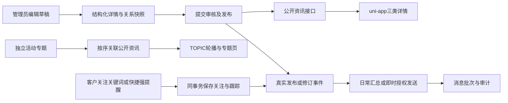

# C 端反馈对齐：开发与接手说明

## 当前基线

本轮按 2026-10-22 反馈修订此前的 HTML 原型重制。新决定覆盖《C端原型重制设计与开发交接-20261021.md》中同名条款，旧文档保留历史。验收结果由本轮验收记录和当前源码对应报告确认，不沿用旧版通过数字。

本地分支：`feature/client-prototype-rebuild-20261021`。包含另一会话已完成的微信手机号登录改造，不更换其真实身份链路，按用户本轮指令交接，不调用真实消息服务。C 端仍为 uni-app 单一源码，管理端仍为 Vue Web。

## 页面及数据规则

| 页面 | 本轮标准 | 工程位置 |
|---|---|---|
| 搜索/首页分类 | 普通信息、通知、攻略三个显示组；普通信息兼容 BASIC/RESOURCE/REVIEW，通知兼容 NOTICE/ACTIVITY，攻略为 GUIDE | `features/catalog.ts`、`pages/search`、`pages/index` |
| 多板块筛选 | 板块之间 OR，标签之间 OR，关键词之间 OR；不同维度 AND。未选板块时搜索全部，不展示全量标签，提示先选板块；切换板块清理不属于当前选择的标签 | ArticleFilter、JdbcArticleRepository |
| 通知详情 | 生效状态、实际开始/截止时间、根据当前时间计算倒计时、正文及原文 | `pages/article` |
| 攻略详情 | 适合人群/时长/难度、正文、结构化步骤、注意事项、原文；未配置时如实留空或提示，不填演示内容 | ArticlePresentation |
| 普通信息详情 | 正文、运营填写联系方式、明确关联且当前公开有效的资讯、原文 | ArticlePresentation、ArticleDetail |
| 板块/标签 | 板块进标签，标签选择关键词并在当前标签内筛选；不提供直接关注板块或标签按钮 | CatalogDetail |
| 关键词关注 | 详情弹窗只列本条资讯关联关键词。服务端写入后再改变选中态，支持重复点击取消 | article、SubscriptionService |
| 资讯关注 | 侧栏点击切换，状态刷新后仍保留；有启用的提醒时取消前说明会一起关闭 | article |
| 活动专题 | 独立内容集合、头图/副标题/介绍/关联资讯顺序，从 TOPIC 轮播和活动列表进入；不通过板块 ID 冒充 | TopicService、activity-column |
| 信息盒子 | 三类盒子、信息类型徽标、实际发布时间、摘要展开及进入全文；左滑仅揭示显式已读确认 | subscriptions |
| 关注管理 | 关键词/信息两 Tab；每个 Tab 按板块→标签→对象折叠，每标签预览四条，更多进入完整组列表；不提供选择板块与标签按钮 | follows、follow-items |
| 资料 | 昵称、脱敏手机号、保存、退出；不展示学校组织和注销入口 | profile |

学校组织仅从要求删除的 C 端搜索及资料入口移除，昵称保存保留已有 organizationId，避免误清空历史资料。管理后台已有资料包、资格评审及组织范围仍使用组织模型。注销底层受控接口与审计保留，C 端不再展示操作入口。

## 强提醒业务状态

这里的“强”是产品命名，不代表可以绕过微信/企微的平台规则。

1. 详情点击强提醒→居中确认→后端同一事务关注资讯并创建/恢复 DAILY 跟踪→侧栏显示已设置。添加跟踪不生成假更新，日常待提醒列表可以为空。
2. 关键词关注同时开启日常跟踪。关键词再次取消时，同时停用该关键词跟踪；历史规则和发送记录保留。
3. 已启用的 INSTANT 规则不会因再次点击快捷日常入口而被偷偷改成 DAILY。恢复已暂停的 INSTANT 规则仍须满足有效授权要求。
4. 取消提醒仅关闭跟踪，不删除普通关注；取消资讯/关键词关注则同时关闭该对象的变更型跟踪。前端所有取消入口说明此影响。兼容日程提醒仍是独立历史模型，不能把它的状态和新变更型提醒混写。
5. 日常页上方显示真实 PENDING/BATCHED 更新，下方为已设置的资讯；取消单次更新与取消整条规则分开。BATCHED 显示等待企微工作人员发送，不能假称撤回或已送达。
6. 即时页使用真实一次性额度，切换模式需明确保存；没有真实平台接线就保持待接入提示。日常时间采用后台提供的三个时段，用户选一个。
7. 关键词页基于实际关注记录，显示关注之后首次发布且当前未读的公开有效资讯总数和最新标题；与“有多少条发送任务”不是同一指标。已暂停跟踪时保留关注，并标明暂停。
8. 用户取消/重新关注不删除发送审计，不增加微信授权额度。所有状态以服务端返回为准。

写操作统一使用 reminder_control→article_replacement_guard 的锁顺序，避免新增联动引入反向锁序。已有 expectedVersion 乐观锁、幂等请求键、权限/租户隔离继续生效。快捷入口按对象复用唯一跟踪记录，不产生重复规则。

## 详情字段怎样编辑

管理后台进入“资讯与审核”，新建资讯或创建修订：

- 选择普通信息/通知/攻略，设置唯一归属板块，选择该板块标签及真实关键词。
- 攻略填写适用说明，逐条添加步骤，注意事项每行一条。
- 普通信息逐条填写联系方式，选择最多十篇相关资讯。
- 通知填写实际生效开始和结束时间。不填截止时间时显示长期有效，不制造倒计时。
- 保存草稿，依次提交、审核、发布。结构化字段随版本保存，草稿修改不会提前影响公开页面。

结构化字段为 `Draft.presentation`，保存进该版本 `relation_snapshot.presentation`，不是从富文本或标题猜取。字段受长度、数量和嵌套校验约束。老版本没有 presentation 时返回空结构，保持兼容。公开相关资讯每次重新校验可见性，下线或到期不会泄漏正文。

## 活动专题怎样配置

1. 管理端“活动与资料→活动专题→新建”。填写标题、副标题、HTTP(S)头图地址、介绍和排序。
2. 选择关联资讯，并用“上移/下移”确定实际显示顺序。最多100篇，不能重复；C 端只展示当前公开有效资讯。
3. 先保存草稿检查，再编辑为 PUBLISHED。编辑提交 expectedVersion，冲突需要刷新，不能覆盖别人刚改的内容。
4. “首页轮播→新建”，链接类型选 TOPIC，目标填写专题编号；填写轮播图片、标题、时间和排序。
5. C 端点击轮播进入独立专题，点击条目进资讯详情。已有 ARTICLE 链接仍直接进入资讯；PAGE 链接仍进入协议等内容页，不自动改写旧轮播配置。
6. 撤下或删除专题后，引用它的轮播自动从公开首页隐藏，直接访问返回404；后台配置与审计保留。

现有“报名活动”和旧“板块栏目”不会自动转换为专题，因为它们业务含义不同。接收团队需要明确创建真实专题、选择实际关联资讯；不自动迁移演示内容。

## 接口变更

| 接口 | 契约 |
|---|---|
| GET /api/v1/articles/search | 新增 categoryIds，最多30个正整数，去重排序；旧 categoryId 继续兼容，同时传入时取交集。快照绑定完整筛选。 |
| POST /api/v1/admin/articles、POST /{id}/versions | 新增可选 presentation，旧客户端省略时生成空结构。 |
| GET /api/v1/articles/{id} | 返回 presentation 和 related，均来自当前公开版本。 |
| POST /api/v1/me/reminders/daily | targetType ARTICLE/KEYWORD + targetId；创建/恢复规则并关注，重复调用复用规则。 |
| GET /api/v1/me/reminders/keywords | 当前用户已关注关键词、新资讯数、最新标题和跟踪状态，最多200项。 |
| GET /api/v1/me/reminders/changes | 可选 mode DAILY/INSTANT，筛选仍有效且版本匹配的跟踪。旧调用不传保持兼容。 |
| GET /api/v1/me/reminders/rules | 可选 enabledOnly，默认false；即时页使用true，不将暂停规则当成授权中规则。 |
| GET /api/v1/topics、GET /api/v1/topics/{id} | 仅公开已发布未删除专题；关联资讯按配置顺序并再次校验可见性。 |
| /api/v1/admin/operation/topics | 工作人员 operation:manage 权限，支持列表、详情、新增、编辑、软删除。 |
| 首页轮播 | linkType 新增 TOPIC，旧 ARTICLE/PAGE 保持兼容。 |
| 信息盒子 | 条目新增 contentType/publishedAt；已读仍绑定 currentVersionId。 |

最终完整契约以运行导出的 `contracts/openapi.json` / yaml 为准。

## 数据库升级和回退

- 新增迁移 V23，建立 activity_topic / activity_topic_article。V1～V22不改写，不需要迁旧 demo 数据。
- 原测试/生产新工程库执行既有 `scripts/database_ops.py migrate`；全新库使用 initialize。先备份并记录应用提交和迁移校验值。
- 本轮发布需要前后端和数据库一起更新。前端依赖新专题与快捷提醒接口，不能仅替换 C 端。
- 回退应用时保留新增表和历史数据，不直接 DROP TABLE。旧应用可以忽略新增表，但旧版不理解 TOPIC 轮播，回退前应撤下 TOPIC 轮播。已有登录模块的前后端仍须一起回退。
- Linux x86_64/amd64 Docker 和现有后端运行配置保持原部署路线，不因本轮页面需求另换运行环境。

## 本地与外部验收边界

本轮需重新构建后端、管理端、H5、微信产物，验证新接口、数据升级、权限、版本冲突、真实页面状态、取消/重试和多尺寸布局。微信登录改造继续跑其专项回归；测试使用纯合成账号和本地通道。

微信开发者工具/真机的原生样式、真实登录授权、微信订阅消息和企微任务执行/回执仍需要平台资源和人工操作，不能以 H5 截图、编译成功或凭据校验代替。正式发布还需要目标 Linux、安全门禁与接收签字。

## 二次开发边界与限制

- 活动专题最多100条关联，专题列表最多100条；资讯后台选择源最多200条，关注与关键词摘要最多200项，盒子每项最多100条。需求扩大前应新增服务端分页/搜索，不把前端截断当全量。
- 板块/标签是运营字典，不固化原型中的6块17标签；关键词允许多标签真实归属，同一个取消动作作用于所有展示分组。无归属的关注在未归类展示。
- 关键词新资讯按首次PUBLISH审计时间计算。已有旧数据缺首次发布审计时兼容published_at；重新关注沿用原始关注时间，不伪造新身份或抹除历史。若业务要按每次重新关注重置窗口，需要独立定义和迁移。
- 本轮不增加消息传输器、不修改登录凭据/部署配置、不强制升级uni-app工具链。真实平台的授权与送达接线未因页面可点而完成。
- 旧版不认识专题及presentation，回退前撤下TOPIC轮播并接受旧版忽略结构化详情；旧表和不可变版本不回写。
- 回归源码在`tests/feedback_suite.py`和`tests/browser_prototype.cjs`，需要修改业务规则时同步更新要求映射，再执行完整验收；不可删除失败场景、扩大成功状态码来制造绿灯。

## 原型可以照做和必须调整的地方

页面顺序、分组、按钮位置、弹窗形式、Tab和详情模板按演示实现；手机外壳、开发工作台侧栏和静态调试控件不进入产品。微信原生导航、安全区域、授权按钮、分享入口按平台能力实现，H5用等价交互。

| 原型/口头表达 | 当前实现及原因 |
|---|---|
| 添加强提醒立即生成PENDING | 立即保存关注与跟踪，后续真实发布/修订才生成更新；否则会把没有发生的内容变化当任务 |
| 每次点即时都加额度、示例累计次数 | 额度来自可信授权，生产客户端不能自己铸造；本地模拟仅通过受控入口 |
| 日常全自动送达 | 后端自动整理及建任务，企微受限环节仍由员工执行；UI区分待人工和已核实发送 |
| 详情的阅读数/来源/步骤演示值 | 只展示真实数据；步骤、联系方式由后台发布，未填写不凭空补例子 |
| 固定学校、标签、关键词列表 | 使用运营字典与真实归属；本轮C端去掉学校组织入口 |
| 所有关闭/已读都是本地切换 | 服务端持久化，版本冲突和失败保留可重试，不以toast替代结果 |

## 人工复核顺序

1. 启动合成工作台，先游客测试首页、搜索、三类筛选、板块/标签浏览，确认没有学校筛选和关注板块按钮。
2. 使用合成客户码登录，分别查看通知、普通信息、攻略；编辑真实测试资讯的presentation并走审核发布后核对字段。
3. 详情原地关注/取消，开启强提醒确认两边状态，刷新核对；取消关注后规则停止，取消提醒后普通关注保留。
4. 关注真实关键词，在管理端发布关联新资讯，检查信息盒子和关键词新资讯计数；修订关注前已发布文章不应充当新资讯。
5. 盒子展开摘要不写已读，左滑后明确确认；用过期版本确认应失败，重新阅读后可确认。
6. 后台创建专题、排序关联资讯、发布并配置TOPIC轮播；C端进入应看到该专题，撤下后轮播消失且旧链接404。
7. 关注管理核对关键词/信息双Tab及三级折叠，个人资料无学校/注销入口；登录仍按同日新流程。
8. 执行`python scripts/workbench.py stop`，固定端口隔离验收不能与人工工作台并行。

本地客户码获取：`python scripts/workbench.py code alice`；模拟授权：`python scripts/workbench.py authorize alice --quota 5`。这些仅供合成工作台，不能交给生产配置或在聊天/报告记录真实密钥。

## 模块与状态流

关注和跟踪是两个域：普通关注决定信息盒子归属，提醒决定外部通道触发条件。开启提醒保证关注存在；关闭提醒不反向删除关注；取消关注停用同对象跟踪。已发生批次及UNKNOWN记录依照原有状态机核实，不因为取消按钮而删除审计或虚构平台撤回。

快捷入口使用全局提醒控制行锁串行变更，并用跟踪唯一键维护每用户每对象最多一条记录。REPEATABLE READ下的存在性/版本判断使用当前读，不能在等锁后仍拿认证阶段的旧快照判断不存在。扩展提醒写路径必须遵循相同锁顺序，不在控制锁内调用外部HTTP服务。

## 默认验收数据

用户补充要求已由独立工作台演示装载器实现。默认启动会创建6篇三类资讯、3个独立专题和3张自有轮播，走真实审核发布流程；正式初始化不导入。参见 [演示数据、空态开关与真机图片地址](演示数据与本地人工验收-20261022.md)。
