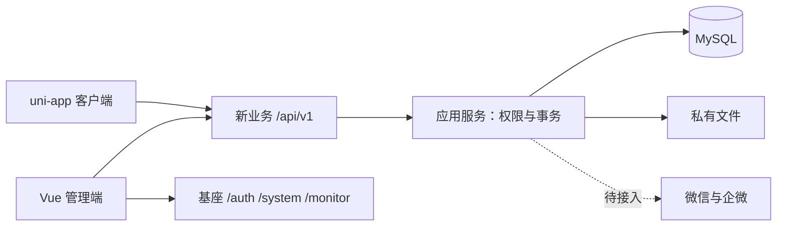

# 云迹二次开发详细教程与注意事项

> **2026-10-27 当前规则替代说明**：现行分支 `feature/product-baseline-rebuild-20261027`，迁移V26，未自动推送。先读[本轮开发与交接](产品基线重制开发与交接-20261027.md)、[本轮二开教程](产品基线二次开发教程-20261027.md)、[逐条台账](spec/产品基线逐条台账-20261027.md)与[本地验收记录](产品基线本地验收记录-20261027.md)。本轮取消内容审核/业务版本、改为保存发布/原位纠错、更替迁移关注提醒、滚动曝光已读、三栏盒子、全局文件活动引用、统一运营角色。下方旧操作与当前规则冲突时停止使用，作为历史参考，不照旧的送审、版本发布、组织权限或旧路由操作。真实提醒发送器尚未接线，不能解释成仅缺密钥。新的候选机器门禁为 `reports/product-release-gate.json`，与生产就绪无关。

## 历史手册正文（旧日期规则，需对照本轮交接）

> **2026-10-22 C 端反馈对齐（当前本地分支 `feature/client-prototype-rebuild-20261021`，本轮接续交接）**：先读 [本轮设计、业务规则与升级步骤](C端反馈对齐设计与交接-20261022.md) 和 [本轮验收记录](C端反馈对齐本地验收记录-20261022.md)。本轮新增 V23 独立活动专题、版本化三类详情及关注/强提醒联动，沿用同日新微信登录。本文下方早期分支、V22 上限和验收数字均为历史；后端/管理端/C 端必须配套升级，真实平台、Linux 和安全发布门禁继续保留。

> **2026-10-22 微信手机号登录更新（随本轮接续交接）**：已接入真实微信身份与可选手机号授权，复用了经用户授权的应用凭据，官方凭据检查通过；原生授权和真机端到端仍待实测。详见 [登录接入、开发工具测试与交接](微信手机号登录接入与验收-20261022.md)。下方 10 月 21 日及更早的推送/验收结论仅适用于对应历史版本。

> 本轮接收更新：用户已完成人工试用并授权推送，工作台已停止。本次接收分支为 [feature/client-prototype-rebuild-20261021](https://github.com/qianyue303jiaojie/yunji-platform/tree/feature/client-prototype-rebuild-20261021)；以下“未自动推送/仅本地”等描述为当时开发阶段记录。接收以该分支远端完整 SHA 为准，旧分支和旧 ZIP 不自动更新；真实平台、Linux 和安全发布门禁继续保留。

> **2026-10-21 C 端原型改版**：当前本地分支为 feature/client-prototype-rebuild-20261021，本轮不自动推送。请先读 [原型重制设计与交接](C端原型重制设计与开发交接-20261021.md) 和 [本轮验收记录](C端原型重制本地验收记录-20261021.md)。下方旧分支、旧界面路径和旧验收数字均为历史记录；最新结果以本轮报告和 reports/release-gate.json 为准。


> 2026-10-16 本地候选更新：先读 [微信交互与企微运营收口交接](微信交互与企微运营收口交接-20261016.md) 和 [当前验收结果](当前阶段与验收结果.md)。新分支 `feature/wechat-ux-closure-20261016` 尚未推送；本页旧分支和验收数字是历史记录，变更状态以最新交接为准。

> **2026-10-13 更新**：本轮变更型强提醒、后台工作区、V21/V22 增量迁移及操作教程见 [强提醒与后台重制开发交接](强提醒与后台重制开发交接-20261013.md)，现状以 [当前阶段与验收结果](当前阶段与验收结果.md) 为准。旧段落中“强提醒本地语义未补齐”和旧验收数字为历史记录；正式身份/授权/模板接线仍待平台资源。本轮接收分支为 `release/test-handoff-20261013`；获取方式、未结事项与团队分工见 [测试与生产接力清单](测试与生产接力清单-20261013.md)。`feature/brand-yunji` 为旧快照。

> 历史决定（2026-10-12，已被后续实现更新）：当时评估完整补齐为中高复杂度。10月13日起已补齐本地变更型提醒，原[实施任务单](强提醒后续实施任务单-接手开发团队.md)保留为历史；当前剩余是真实平台接线、资源联调与生产门禁。

基础教程初版：2026-10-12，现行更新：2026-10-21。读者：接手开发的后端、前端、测试人员。以当前重制工程源码为依据；生产操作另见 [部署团队交接操作书](部署团队交接操作书.md) 和 [容器适配说明](../deploy/docker/README.md)。

当前本地分支为 `feature/client-prototype-rebuild-20261021`；`feature/brand-yunji` 为历史归档。接收时核对实际分支完整提交，当前本轮未推送；GitHub 上旧提交和旧交付 ZIP 不能代表本轮代码。操作前先看 `git status`，不要用 reset、clean 或切换分支清掉正在验收的改动。

## 1. 先读什么，如何理解工程

建议阅读顺序：

1. [当前阶段与验收结果](当前阶段与验收结果.md)：明确已有能力、验证范围和未完成项。
2. [三端改造交接与使用说明](三端改造交接与使用说明-20261012.md)：了解用户入口和运营操作。
3. [强提醒开发交接](强提醒与后台重制开发交接-20261013.md)：阅读当前变更跟踪、冻结批次与渠道边界；10月12日的专项核查仅保留为历史分析。
4. `contracts/openapi.yaml`、`contracts/endpoint-matrix.json`：核对当前接口、主体和字段。
5. [开发与维护手册](开发与维护手册.md)：阅读权限、事务、文件和版本模型。

工程从授权公司基座实现新业务。`yangben` 只允许作为需求研究和来源核查对象，不是依赖，不接入运行库，不复制业务代码、表结构、页面或部署脚本。业务功能可以参考，接口和领域模型必须重新设计。



### 目录定位

| 目录或文件 | 开发用途 |
| --- | --- |
| `backend/agri-admin` | API 启动入口和运行配置，构建得到可执行 JAR |
| `backend/agri-modules/yunji-content/src/main/java/com/sunshine/yunji/content` | 独立新业务，各领域按 `api/application/domain/infrastructure` 组织；有些领域尚未完整拆层 |
| `apps/client/src/pages` | uni-app 页面，H5 和微信小程序唯一源代码 |
| `apps/client/src/pages.json` | 页面注册、原生导航及页面标题 |
| `apps/client/src/api/platform.ts` | 客户端请求、客户会话、幂等键、导航、上传下载 |
| `apps/client/src/styles/app.scss` | 客户端公共样式；页面局部样式放对应组件 |
| `apps/admin/src/main.ts` | 管理端路由和登录守卫 |
| `apps/admin/src/App.vue` | 导航分组、面包屑和工作台壳 |
| `apps/admin/src/views` | 管理端页面 |
| `apps/admin/src/workspaces.ts`、`views/Workspace.vue` | 简单维护模块的字段配置和页面控件；不能无限扩展成承载所有业务的万能页面 |
| `apps/admin/src/api/client.ts`、`permissions.ts` | 工作人员请求封装和前端权限展示 |
| `database/migrations` | 当前 V1–V20；未来变更从 V21 起，只增不改 |
| `contracts/view-models.json` | 一部分共享边界模型的人工维护源 |
| `scripts/generate_view_models.py` | 生成 Java `Views` 和两端 `types/models.ts` |
| `tests` | API、浏览器、领域边界验收场景 |
| `scripts` | 构建、隔离运行、数据库操作、报告与打包工具 |
| `reports` | 实际执行证据；报告时间、源码指纹和失败项都需核对 |
| `.runtime` | 忽略的本地库、日志和私密工作台文件；不要提交或打包 |

### 几个容易混淆的概念

- 板块对应分类维度；学校/组织是独立维度，不是标签父节点。
- 标签唯一归属板块，父级用于组织展示；精确匹配，不隐式包含后代。关键词独立，标签关联关键词从公开文章关系推导。
- 关注、收藏、已读、提醒规则是不同状态。收藏不等于关注，已读不等于取消提醒，当前规则也不会因为已读自动取消待推送。
- 创建草稿、审核通过和发布不是同一件事。公开内容使用当前发布版本，不能让编辑直接改公开投影。
- 业务状态“提醒启用”不等于平台已绑定，更不等于已经送达。
- 客户账号和工作人员账号是两套主体，不应交换 token。

## 2. 接手前先保护工作区

在 PowerShell 中执行：

```powershell
Set-Location D:\yunjiwxCongxie\yunji-platform
git status --short
git branch --show-current
git log -5 --oneline
git remote -v
```

这些是查看命令。未提交文件不是无用文件，不直接执行 `git clean -fd`。需要隔离开发时，从明确的已提交基线创建新分支或 worktree；当前工作区存在未提交基线时，应先完成版本归档，不能假定 worktree 会自动包含未提交内容。

本地修复与远程发布分开处理。没有本轮推送指令时，先保持本地可审查结果。获准发布后记录提交编号、分支、构建结果和外部未完成项，不把 push 当作生产批准。

## 3. 环境准备和第一次运行

### 3.1 工具与依赖

当前本地运行器面向 Windows。JDK 21、Maven 3.9、MySQL 8 服务端及客户端、Redis、Node.js/npm、Python 3.10+ 都要可用。Java 编译目标仍由现有 POM 决定，不能因为使用 JDK 21 就擅改框架编译目标。

Linux amd64 是已确认的接收目标。Windows 隔离运行器不是跨平台部署工具；Linux 使用 `deploy/` 和容器交付流程。

```powershell
python -m pip install -r scripts/requirements.txt
npm ci --prefix apps/admin
npm ci --prefix apps/client
npm ci --prefix tests
Push-Location tests
npx playwright install chromium
Pop-Location
```

`npm ci` 严格使用锁文件。不要用 `npm audit fix --force` 修改 uni-app 的兼容依赖链。网络下载失败先定位镜像、代理和日志，不把安装失败解释成业务缺陷。

运行器支持以下本地路径覆盖，真实安装不同才填写：

```powershell
$env:PYTHONUTF8 = '1'
$env:YUNJI_TEST_JAVA = 'C:\Program Files\Java\jdk-21.0.10\bin\java.exe'
$env:YUNJI_TEST_MAVEN = 'D:\devenv\maven\apache-maven-3.9.16\bin\mvn.cmd'
$env:YUNJI_TEST_MYSQL_BIN = 'D:\devenv\mysql\bin'
$env:YUNJI_REDIS_SERVER = 'D:\devenv\redis\redis-server.exe'
```

必要时 `YUNJI_TEST_MAVEN_SETTINGS` 指向本机忽略的 Maven settings。不要把个人代理、仓库凭据或私有镜像密码写进 POM 或提交到 Git。

### 3.2 人工工作台

```powershell
python scripts/workbench.py start
```

保持启动进程运行，另一个终端执行：

```powershell
python scripts/workbench.py status
python scripts/workbench.py code alice
```

| 服务 | 地址/端口 | 用途 |
| --- | --- | --- |
| C 端 | `http://127.0.0.1:5173/#/` | 浏览器人工测试，开发模式 |
| 管理端 | `http://127.0.0.1:5174/#/` | 工作人员操作，本地管理员 `admin/admin123` |
| API | `http://127.0.0.1:18088` | 本地后端 |
| MySQL | `127.0.0.1:33308` | 运行器创建的独立测试库 |
| Redis | `127.0.0.1:16379` | 独立测试缓存 |

客户端登录码两分钟有效、单次使用。过期重新签发。刷新后登录异常先确认是不是换了工作台新库，旧浏览器 token 不能登录新库。

每次启动创建新的 `.runtime/run-*` 和合成数据，不自动沿用上次人工录入。测试前需要保留的结果应记录或在明确范围内导出；不能将它当作持久开发数据库。

结束时：

```powershell
python scripts/workbench.py stop
```

或在启动终端 Ctrl+C。脚本只停止自己创建的进程。遇到端口占用，先定位进程和用途，不随意终止机器上的 Java/MySQL/Node 服务。

### 3.3 微信开发工具

```powershell
npm run build:mp-weixin --prefix apps/client
```

上述是通用编译包。2026-10-22 起，本机真实微信测试推荐执行 `python scripts/build_wechat_test.py`，导入 `.runtime/wechat-devtools`；脚本填充生成项目的 AppID，不改受追踪的 manifest。正式测试仍需要开发者权限和可达的 HTTPS API，详见 [手机号登录专项交接](微信手机号登录接入与验收-20261022.md)。

`VITE_API_BASE_URL` 是前端 API 地址；真实登录提交的 AppID 来自微信运行时 `uni.getAccountInfoSync()`。`VITE_WECHAT_APP_ID` 供专用构建脚本填写开发者工具项目配置。AppSecret、企微应用密钥只放服务器受控配置。真机的 `127.0.0.1` 是手机自身，不是开发电脑。

微信工具的模拟构建成功不证明授权、域名、文件选择、订阅消息和前后台生命周期均通过。H5 的 DOM API 放在 `#ifdef H5` 分支中；不能把 `document/window` 无条件放入小程序页面。

## 4. 后端开发教程

### 4.1 修改之前写清业务规则

以“增加标签属性”为例，先列出：谁可改、是否影响文章历史版本、空值语义、唯一性、是否可公开、并发冲突、是否需要迁移。不要先改数据库，再让前端猜字段含义。

建议每个任务在开发日志中写下：业务触发 → 输入 → 允许状态 → 输出 → 权限 → 并发处理 → 失败恢复 → 验收案例。

### 4.2 一个新业务写接口的流程

1. 在对应领域 `api` 定义请求 DTO，明确必填、长度、枚举、ID 和时间格式。
2. 在 `application` 校验工作人员权限或客户身份、对象归属、可见性和状态。
3. 写动作通过事务服务完成；组合数据和审计在同一业务事务中保存。
4. 更新使用 `expectedVersion` 校验当前 `lockVersion`；冲突返回 409，不能最后一次提交覆盖其他人的结果。
5. `/api/v1` 业务写接口继续使用现有幂等处理链，不另写一套“客户端随机 ID 等于幂等”的机制。
6. 优先类型化响应 DTO；已有动态 Map 不意味着新接口可以任意改变返回字段。
7. 添加实际行为测试：正常、无权限/跨用户、非法状态、版本冲突、重复请求和必要失败恢复。
8. 构建并启动新版本后导出实际契约，再同步两端与文档。

可阅读真实参考：`catalog/api/LabelController.java`、`catalog/application/LabelService.java`。它们包含输入校验、目录权限、行锁、版本冲突、父级循环校验和审计；这是新工程参考，不来自 demo。

### 4.3 数据库变更

当前最高版本是 V20，下一份为 `V21__明确含义.sql`。开始任务时重新查看最高编号；多人分支合并之前解决编号冲突，已在任一共享环境应用的迁移不能重写。

必须考虑：

- 新空库从头初始化以及已安装库增量升级都可执行。
- 已有数据的默认值/回填策略、空值、引用、唯一约束和索引。
- MySQL DDL 可能部分提交，失败恢复不能靠简单重跑。
- 大表回填或索引变更需要迁移窗口评估；生产人员执行并留下结果。
- 数据回滚与代码回滚不同。向前兼容或恢复备份必须设计，不能自动删列降级。

使用 `scripts/database_ops.py` 的 `initialize/migrate/bootstrap/backup/restore` 操作现有部署流程；查看帮助并按部署文档配置。`initialize` 只允许新库，生产不加载 `database/fixtures/local.sql`。

### 4.4 内容版本与关系

文章标签、关键词和板块进入 `article_version` 的关系快照；发布时更新公开投影。新字段若属于发布内容，应判断是否也需要进入不可变快照，不能只存在主表并让历史版本变样。

修改的典型链路：请求 DTO → 约束验证 → 草稿版本/关系快照 → 发布投影 → 查询响应 → 管理编辑表单 → C 端展示 → 契约/用例。

更替涉及关注迁移、提醒迁移、历史记录和幂等；不得只把旧文章下线、改一个 URL。旧版快照缺少新增字段时必须有明确兼容语义，例如 V20 的 `labelIds` 缺省按空集合解释。

### 4.5 权限与 ID

工作人员使用 STAFF 身份和 `yunji:*` 权限；客户通过 `Actors.customer(request)` 识别自身。客户端提交 `userId` 不能当作身份来源。后台按钮隐藏仅帮助使用体验，后端必须再次检查。

Java 端可用 `long`，HTTP 边界中的大 ID 输出为字符串。TypeScript 中不要 `Number(id)`、`parseInt(id)` 后再传回，避免 53 位精度损失。统计数量可以是数字，实体标识和数量不能混用。

查询参数使用绑定，不拼接用户输入到 SQL。动态排序只允许白名单列。公开、登录客户、工作人员三个读范围都要验证。

### 4.6 类型和契约

修改生成模型的源应编辑 `contracts/view-models.json`，然后：

```powershell
python scripts/generate_view_models.py
```

不要直接改生成的 `Views.java` 或两端 `types/models.ts`。不是所有新 DTO 都在生成清单内，例如 LabelController 的局部响应记录要独立维护；生成器不自动覆盖所有 Controller。

OpenAPI 是实际运行导出的快照，不只是手写草稿。执行 API 验收后运行 `contract_reconciliation.py`，检查新增路径/身份/响应。新增接口还需要更新计划/要求中的真实语义，路径未决为 0 不等于所有功能完成。

## 5. C 端页面和 UI 二次开发

### 5.1 新增一个独立页面

以新增“我的某类记录”为示例：

1. 确定独立业务语义以及 API 是否已提供完整过滤/分页。
2. 新建 `apps/client/src/pages/<页面名>/index.vue`。
3. 在 `pages.json` 注册页面和标题；只有四个主入口属于原生 tabBar。
4. 使用 `platform.ts` 的 `request` 和 `navigate`；tab 页使用 switchTab，普通详情使用 navigateTo。
5. 页面处理 loading、空态、失败、游客、退出登录、重新进入，以及请求未完成的重复点击。
6. 列表项以稳定 ID 为 key，分页防并发，切换筛选清掉旧 cursor/snapshot。
7. 需要登录时保留返回目的地，并提供退出登录页的有效路径。
8. H5 和小程序都构建，检查窄屏、长标题、软键盘和安全区。

请求示例（使用实际存在的接口）：

```ts
import { request, type Row } from '../../api/platform'
const labels = await request<Row[]>('GET', '/api/v1/catalog/labels')
```

这里只演示请求封装；真实页面应定义所需 DTO，并控制请求生命周期，不能复制示例就宣称完成分页或权限处理。

### 5.2 美化时避免改坏业务

- 先复用 `app.scss` 的间距、文字和控件体系；新增公共样式用明确类名，不全局覆写 `view/button/text` 影响所有页面。
- 密集布局保持可点击区域，正文支持长标题/换行，底部固定栏留安全区与滚动空间。
- 不把所有功能塞进一个长页；搜索、记录和提醒已经拆为独立入口。
- 页面文案不能超出后端能力。缺绑定时显示待授权/待接入；空资料库提示运营发布，不填假资料。
- 不把客户不关心的数据库状态码直接写在卡片上；开发诊断放日志和后台说明。
- 颜色与排版调整后核查加载态、失败态、按钮 disabled、选中态与底部导航。
- 不复制第三方品牌标识、图片或旧 demo 页面；可以参考信息层次，资产来源要可追踪。

### 5.3 保存和重试

当前请求封装会为写请求生成幂等键，并保留部分未知结果请求的键。开发时不能在请求前后随意重建请求内容，使重试变成第二个不同业务操作。

409：重新拉取当前版本，再提示用户确认；401：清会话并引导登录；422：展示可理解的输入问题；503：说明能力不可用。网络未知结果不能统一当作“服务器没保存”。

文件上传和下载用现有封装。下载票据短时、单次、绑定主体；不要把真实附件目录或永久文件 URL 绕过权限展示出来。显示服务器 SHA256 不等于客户端已验证全部下载字节。

## 6. 管理端扩展教程

### 6.1 简单目录维护还是独立业务页面

字段少、操作简单的目录可以扩展 `workspaces.ts`，使用现有独立列表/新建/编辑/详情路由；复杂审核、更替、批量事务、业务统计应创建专用 view。

新增 view 后要同步：`main.ts` 路由 → `App.vue` 导航分组/面包屑 → `permissions.ts` 展示权限 → 后端真实权限和菜单授权 → 对应测试。

当前 Foundation 的表单和详情是同模块内屏幕状态，不能把所有页面都描述为已有独立 URL。若需要直接链接、刷新恢复和浏览器返回，应改为明确路由并重新验收。

### 6.2 分页和搜索的真实范围

部分旧业务列表接口封顶 100/200/500 条，Workspace 搜索/分页只作用于“已加载”记录。不能仅去掉提示并展示“全库共 N 条”。客户目录使用真实服务器分页，其他需要全库查询的模块要从后端补分页。

升级分页流程：设计过滤条件/排序 → 服务端 count 与 page/cursor → 主体/数据范围一致 → 请求 DTO → 页面页码重置 → 测试跨页不重复/不漏以及过滤变化 → 更新契约和数量口径。

批量删除必须二次确认，并说明部分失败处理。引用保护由服务器实现，不能在前端隐藏被引用记录后当作保护。配置、密钥和 token 不放入表格或导出。

## 7. 强提醒开发的特别注意

当前强提醒使用 ReminderTrackingService / ReminderBatchService 的变更跟踪与冻结批次；NotificationService 规则型日程作为兼容入口独立保留，不混用账本。10月12日[专项核查](强提醒逻辑核查与后续开发说明-20261012.md)所列本地语义缺口已在后续实现中处理，当前证据见 reminder-rebuild 与 browser-reminder-rebuild。

最关键的区分：

- 规则：用户希望跟踪谁、何时提醒。
- 触发项：哪一次内容更新导致这个用户需要提醒。
- 投递：一次发给哪个通道、包含哪些已冻结触发项的请求。
- 回执：供应商接受、实际送达/失败和未知结果分别记录。

新强提醒 DAILY 汇总待处理的新增未读变更；确认展示版本已读可抑制对应未冻结触发项，同时保留跟踪。已冻结或已提交外部平台的批次不能声称被撤回；后续变更留在独立待处理集合。兼容日程 DAILY 仍是原规则语义，不能拿其接口替换新强提醒。

自动强提醒调度已在本地工作台启用，管理端仍可手动处理和核实本地任务；生产供应商发送接线未完成。兼容日程 `tick` 明确限本地模拟。`workbench.py authorize alice --quota 5` 只生成合成授权，绝不能作为生产授权入口。

任何生产通道必须有专用适配器、超时/幂等/额度/回执与签名验证。`UNKNOWN` 不能盲目自动重发。企微外部联系人群发任务创建不能直接记为 `SENT`，应用消息与客户群发的 API 语义要先确认。

## 8. 本地验收与报告更新

### 8.1 避免端口和数据库互相干扰

人工工作台与 API/浏览器验收使用相同的主要端口。完整自动验收前先保存人工测试记录，停止工作台。不能在用户正在测试时偷偷重置测试库。

验证命令从仓库根目录执行。前端只改排版时先做类型检查、对应构建和人工视觉检查；修改业务交互补真实页面回归；涉及后端/数据库则执行对应 API/运维验证。最终更新整体交付证据时需形成同版本完整报告。

```powershell
python scripts/build_acceptance.py
python scripts/acceptance.py
python scripts/browser_acceptance.py
python scripts/operations_acceptance.py
python scripts/contract_reconciliation.py
python scripts/provenance_audit.py
python scripts/sbom_inventory.py
python scripts/security_inventory.py
python scripts/three_end_review.py
python scripts/feature_review.py
python scripts/gate_report.py
```

不要同时运行多份 API/浏览器工作台；后端 clean/build 与运行中的 JAR 文件也应顺序安排。运维脚本使用独立端口，但并行执行仍需确认不会抢构建产物或变更源码。

### 8.2 结果如何读

| 报告 | 关键字段 |
| --- | --- |
| `build.json` | 六项状态、sourceUnchanged、源码与产物指纹 |
| `latest.json` | API cases、failed、fatal、源码指纹 |
| `browser-execution.json` | 三套执行退出码、sourceUnchanged、对应报告 SHA256 |
| `browser*.json` | 真实页面断言、运行错误与失败页面 |
| `operations.json` | 迁移/恢复/启动演练，不等于 Linux 容器验收 |
| `security.json` | scanComplete 与 releaseSecurityEligible 是不同结论 |
| `three-end-acceptance.json` | 固定场景和决策矩阵，不代表与 demo 逻辑完全一致 |
| `release-gate.json` | 本地证据是否新鲜、外部验收和发布门禁 |

2026-10-12 的已执行快照为 API 282、浏览器 103、运维 20、构建 6，通过代表这些场景，不自动覆盖本次新发现的强提醒业务差异。源码变化后旧报告不能自动继承。纯文档审计也不能编造新功能 PASS。

## 9. 故障定位速查

| 现象 | 首先检查 | 正确处理 |
| --- | --- | --- |
| 端口已占用 | 5173/5174/18088/33308/16379 的实际进程 | 识别归属后停止本工作台；不批量杀同名程序 |
| 登录码无效 | 是否超过两分钟/已消费，是否换新库 | 重新签发；不要绕过鉴权 |
| 浏览器旧账号失效 | 工作台是否新启动、token 是否来自旧库 | 清旧会话重新登录 |
| 提醒不发送 | 是否运行 tick、规则模式、绑定/额度、静默时间、账本状态 | 查看实际状态；当前真实平台尚未接线 |
| 更替后没即时消息 | 更替是否只有目标迁移而无提醒事件 | 对照专项核查；不是刷新页面能解决 |
| 列表找不到后面的记录 | 接口上限、筛选范围、cursor/snapshot | 补服务器分页；不隐瞒上限 |
| 409 保存失败 | expectedVersion 和数据库当前版本 | 刷新并让用户确认，不重试覆盖 |
| 下载票据失效 | 单次使用/有效期/主体 | 重新取票据，避免开放文件目录 |
| Maven 卡住 | 构建日志、网络、settings、遗留本次子进程 | 使用本机 settings 处理镜像，不随意改生产依赖 |
| 小程序无法请求 | HTTPS 地址、AppID、域名及真机网络 | 区分 H5/开发工具/真机配置 |
| 扫描命令成功但发布失败 | releaseSecurityEligible | 风险没有清零，命令成功仅表示扫描完成 |

日志在本次 `.runtime/run-*/api.log`、`admin-vite.log`、`client-vite.log`，构建日志在 `reports/build/`。分享日志前排除登录码、token、个人身份和密钥；保留请求路径、业务编号、错误和时间即可。

## 10. 文档、版本和交接怎么闭环

每次开发日志记录：输入/判断 → 实际改动 → 迁移和接口影响 → 验证命令/报告 → 未完成项。只有执行过的检查写通过；设计建议写“拟议”。

影响使用流程时更新使用说明；影响平台语义时更新专项规则；影响接口时更新契约；影响部署时更新 deploy 与交接操作。遗留旧数字应注明日期，入口文档指向当前结果。

获准归档后，先确认源码/报告指纹，再在工程外生成新包：

```powershell
python scripts/delivery_bundle.py --destination D:\yunjiwxCongxie\yunji-delivery
```

交付包应含源码、JAR、管理端、H5、小程序构建、迁移、报告、SBOM 和 manifest，不含 `.runtime`、node_modules、密钥和旧样本。只执行文档任务时不必重打大包。真实平台、Linux 和安全门禁未通过时仍是研发候选包。

## 11. 接手者完成一个任务的检查表

- [ ] 需求规则明确，和页面名称/历史笔记没有混淆。
- [ ] 身份、权限、数据范围、状态、冲突与失败恢复有明确实现。
- [ ] 新迁移不改历史版本，空库/升级路径有证据。
- [ ] 两端使用当前契约，大 ID/时区/可空语义一致。
- [ ] 列表范围、空态、失败态与平台状态真实呈现。
- [ ] 验收覆盖实际行为，不通过删断言消除失败。
- [ ] 文档和日志说明已做/未做；没有把模拟回执当送达。
- [ ] 构建、报告、源码版本一致，未自动提交/推送未获准的本地试验。

## 2026-10-21 原型重制后的扩展教程

以下针对本轮 C 端结构；入口与版本以《C端原型重制设计与开发交接-20261021.md》和对应验收记录为准。

1. **先定义真实业务语义。** 原型里的数字、手机号、授权次数和点击成功提示不是接口契约。先核对现有实体与可见性、权限、状态、版本，再决定接口扩展。不存在的活动专题聚合关系不能由前端按标题猜测。
2. **扩展页面。** 在 apps/client/src/pages 新增页面，并登记 pages.json。微信原生导航和首页胶囊避让分别处理；不要在业务页面加入演示器的假手机外壳。私有入口加入 api/platform.ts 的 privatePages，普通页面根挂载 LoginSheet，并在 onHide 放弃未完成登录意图。共享目录组件由页面根传入路由参数、转接 onShow/onReachBottom；普通组件不能被假定拥有页面生命周期。
3. **复用组件。** 板块/标签使用 CatalogDetail；个人列表使用 PersonalList；加载、失败和空态使用 PageState。关注分组统一调用 features/follows，不能在更多列表里再写另一套归组规则。跨端主题在 tokens.scss，布局在 prototype.scss，不能只改 H5 的 uni-button 后忘记原生 button。
4. **登录与异步。** authenticated(action) 仅保留当前用户明确发起的简单动作；表单和破坏性操作应回到确认步骤。离页必须使旧 attempt 失效；异步响应写 token、跳转前核对 attempt。不要把单次 code、密钥或完整身份写入日志。
5. **筛选与分页。** 筛选弹窗操作 draft，确认后才替换 applied 状态。类型内 OR、关键词内 OR，与板块/标签/学校条件 AND。任何筛选变化都要清空旧 cursor/snapshot，服务端游标必须绑定过滤条件。首页运营推荐按 articleId 与检索结果去重；保留运营配置入口，不用写死样例卡片覆盖运营数据。
6. **契约修改。** 返回模型优先修改 contracts/view-models.json，再运行 python scripts/generate_view_models.py；Java/管理员/C端生成文件必须一并检查。新增后端接口要补权限、同租户/公开可见性、校验及契约证据。写入继续用现有幂等协议，批量选择必须在同一事务中完成，验证失败不能部分提交。
7. **提醒与已读。** DAILY/INSTANT 是规则模式，关键词是对象视图，三种计数不能相加。建立跟踪不等于生成待发消息。确认已读必须提交屏幕所见 versionId，409 后先加载并阅读新正文。滑动只揭示按钮，不应隐式写已读。真实微信授权和企微任务仍受平台就绪条件约束。
8. **本地验证。** 改动后先运行对应 typecheck/HTTP/浏览器场景，再完成 build_acceptance、acceptance、reminder_acceptance、browser_acceptance、client_compat_acceptance 和 operations_acceptance。构建之后再生成 SBOM 并刷新安全、来源、契约及门禁报告。执行时冻结应用、测试与脚本，sourceUnchanged=false 的旧结果不能当作当前通过。临时数据和 code 在 .runtime，禁止提交。
9. **新版本交接。** 更新开发日志、使用说明、接口变化、验收记录和剩余边界，明确数据库是否变化及成对回滚方式。参考 docs/spec/client-prototype-requirements.json 维护场景映射。只有微信开发工具/真机与目标 Linux Docker 实测通过后，才能增加相应证据，不能把编译报告改名当成真机验收。
