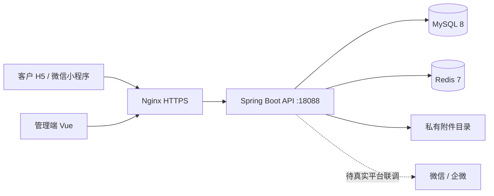

# 云迹重制工程开发与维护手册

> **2026-10-27 当前规则替代说明**：现行分支 `feature/product-baseline-rebuild-20261027`，迁移V26，未自动推送。先读[本轮开发与交接](产品基线重制开发与交接-20261027.md)、[本轮二开教程](产品基线二次开发教程-20261027.md)、[逐条台账](spec/产品基线逐条台账-20261027.md)与[本地验收记录](产品基线本地验收记录-20261027.md)。本轮取消内容审核/业务版本、改为保存发布/原位纠错、更替迁移关注提醒、滚动曝光已读、三栏盒子、全局文件活动引用、统一运营角色。下方旧操作与当前规则冲突时停止使用，作为历史参考，不照旧的送审、版本发布、组织权限或旧路由操作。真实提醒发送器尚未接线，不能解释成仅缺密钥。新的候选机器门禁为 `reports/product-release-gate.json`，与生产就绪无关。

## 历史手册正文（旧日期规则，需对照本轮交接）

> **2026-10-22 C 端反馈对齐（当前本地分支 `feature/client-prototype-rebuild-20261021`，本轮接续交接）**：先读 [本轮设计、业务规则与升级步骤](C端反馈对齐设计与交接-20261022.md) 和 [本轮验收记录](C端反馈对齐本地验收记录-20261022.md)。本轮新增 V23 独立活动专题、版本化三类详情及关注/强提醒联动，沿用同日新微信登录。本文下方早期分支、V22 上限和验收数字均为历史；后端/管理端/C 端必须配套升级，真实平台、Linux 和安全发布门禁继续保留。

> **2026-10-21 C 端原型改版**：当前本地分支为 feature/client-prototype-rebuild-20261021，本轮不自动推送。请先读 [原型重制设计与交接](C端原型重制设计与开发交接-20261021.md) 和 [本轮验收记录](C端原型重制本地验收记录-20261021.md)。下方旧分支、旧界面路径和旧验收数字均为历史记录；最新结果以本轮报告和 reports/release-gate.json 为准。


> 2026-10-16 本地候选更新：先读 [微信交互与企微运营收口交接](微信交互与企微运营收口交接-20261016.md) 和 [当前验收结果](当前阶段与验收结果.md)。新分支 `feature/wechat-ux-closure-20261016` 尚未推送；本页旧分支和验收数字是历史记录，变更状态以最新交接为准。

> **2026-10-13 更新**：本轮变更型强提醒、后台工作区、V21/V22 增量迁移及操作教程见 [强提醒与后台重制开发交接](强提醒与后台重制开发交接-20261013.md)，现状以 [当前阶段与验收结果](当前阶段与验收结果.md) 为准。旧段落中“强提醒本地语义未补齐”和旧验收数字为历史记录；正式身份/授权/模板接线仍待平台资源。本轮接收分支为 `release/test-handoff-20261013`；获取方式、未结事项与团队分工见 [测试与生产接力清单](测试与生产接力清单-20261013.md)。`feature/brand-yunji` 为旧快照。

> 2026-10-12 三端改造补充：请先阅读 [三端改造交接与使用说明（2026-10-12）](三端改造交接与使用说明-20261012.md)。本轮新增 V20、独立搜索/板块/个人记录/提醒页面、后台分组与基座模块入口；Linux amd64/Docker 已确认，容器模板尚待目标机实测。下文旧验收数字只代表其注明日期，当前结论以本轮验收报告为准。

> 接手教程见 [二次开发详细教程](二次开发详细教程与注意事项.md)；强提醒业务差异见 [专项核查](强提醒逻辑核查与后续开发说明-20261012.md)。

文档基线：2026-10-06，适用于仓库 `yunji-platform` 的本地基线验收候选版。每次发布候选必须对照代码、迁移和 `reports/release-gate.json` 更新本手册。当前本地独立验收已完成，但 `localFeatureAcceptanceComplete=false`、`releaseEligible=false` 仍表示真实平台、目标 Linux、安全和团队签字门禁未满足；本手册不授予生产发布资格。

## 1. 工程边界与读者

目标是从公司 `cis4j` 首次框架基座实现云迹业务。`yangben` 仅作为需求线索和来源审计对象，不是业务代码、数据库表结构、前端组件、接口兼容层或部署脚本的来源。框架允许使用的提交、文件哈希和核查局限见 [源码来源核查](decisions/源码来源核查.md) 与 `reports/provenance.json`。旧数据若要迁入，必须另做只读导出、字段映射、脱敏 dry-run 和验收；当前工程没有旧数据导入器，参见 [版本与数据迁移策略](版本与数据迁移策略.md)。

读者分工：后端开发负责领域规则、鉴权、事务、迁移和 API；前端开发负责管理端及 C 端状态/交互；测试负责黑盒回环与反向权限；运维负责目标 Linux 环境、密钥、备份和演练。部署操作按 [部署团队交接操作书](部署团队交接操作书.md) 执行。

## 2. 运行视图和目录



| 路径 | 职责与边界 |
| --- | --- |
| `backend/` | 公司框架聚合工程，`agri-admin` 为可执行 JAR；`backend/pom.xml` 编译 source/target 为 Java 17，现选定 JDK 21 构建和运行。 |
| `backend/agri-modules/yunji-content/` | 新业务模块。按 `identity`、`catalog`、`article`、`subscription`、`engagement`、`activity`、`review`、`resource`、`operation`、`notification`、`analytics` 和 `shared` 划分。模块内 `api` 接受请求、`application` 编排规则、`domain` 表达领域模型、`infrastructure` 接外部存储或平台。不是每个模块都已完成该层次拆分。 |
| `apps/admin/` | Vue 3 + TypeScript + Vite 管理端；基座工作人员登录，业务菜单、系统管理和运营页面。 |
| `apps/client/` | uni-app Vue 3 + TypeScript C 端；同一源码构建 H5 与微信小程序。 |
| `database/framework-schema.sql` | 公司首次框架 schema，是**新空库**初始化的第一份 SQL，含框架初始账号；必须随后执行 `bootstrap`，生产不能导入测试夹具。 |
| `database/migrations/V*__*.sql` | 新业务的有序迁移，当前到 V20；已应用文件不可修改。 |
| `database/fixtures/` | 一次性本地合成验收数据，只允许隔离运行器加载。 |
| `scripts/` | 本地工作台、验收、发布证据、数据库生命周期与交付包工具。 |
| `contracts/` | 当前运行实例导出的 OpenAPI 与路径/身份矩阵；与计划接口存在差异，不能推定旧路径兼容。 |
| `deploy/` | Linux 环境模板、Nginx、systemd；目标机验证尚未完成。 |
| `reports/` | 证据与门禁快照；看生成时间、源码指纹和失败项，不把报告当永久结论。 |

运行边界是同源 HTTPS 网关：H5 在 `/`，管理端在 `/admin/`，API 在 `/api`、`/auth`、`/system` 等路径；MySQL、Redis、API 仅在内网或回环。小程序不由 Nginx 托管，需另交微信开发者工具和平台流程。Nginx 不能直接暴露 `YUNJI_STORAGE_ROOT`。

## 3. 身份、授权与安全不变量

工作人员使用公司基座 `sys_user`、角色菜单和 Sa-Token 的 STAFF token；客户使用 `app_user`、`app_user_identity`、`customer_session` 和独立的 Bearer token。两类主体不能互换。业务 API 虽在框架 `security.excludes` 中交由业务层处理，Controller/Service 必须通过 `Actors.staff()`、`Actors.customer(request)` 和具体权限/归属检查完成服务端鉴权；不能因为前端隐藏按钮就放行。生产启动保护见 `ProductionGuard`：拒绝 `local-enabled=true`、短于 48 字符的 STAFF token secret、默认管理员口令、仍启用的框架测试账号；`local` profile 只允许回环地址，并且不得与 `prod` 组合。

工作人员最小权限来自 V12 菜单，例如 `yunji:article:write/review/publish`、`yunji:file:manage`；具体资源还需组织/作者/评审范围检查。客户读写只针对自己可见的对象。失败鉴权应避免泄露跨租户或跨组织对象存在性。新写接口要同时检查：主体、角色、数据范围、状态转换、字段约束、重复提交、审计和并发条件。当前已覆盖的角色和写操作有回环证据，但权限矩阵全量交叉组合仍需接收团队按批准矩阵签字，不能由当前 API 用例数代替。

真实微信 `code` 交换位于 `WechatGateway`，需要 AppID、AppSecret 和真实环境联调；当前仅验证过本地合成路径。身份 HMAC 密钥和 32 字节 Base64 加密密钥必须持久保管，随意轮换会影响已有身份匹配/解密。真实微信/企微通知供应商与回调适配尚未完成；生产通知处理明确拒绝使用 `LOCAL_FAKE`。客户 H5 的生产登录页提示使用小程序登录，当前没有无平台资源的生产客户登录方案。

## 4. 数据与业务状态模型

数据库使用 MySQL 8、`utf8mb4`、UTC 存储，界面按 `Asia/Shanghai` 等指定时区显示。`Db` 对 JDBC 值使用参数绑定，并将查询结果中的 ID 转为字符串；新增 DTO 仍需明确声明 ID 字符串、可空字段、时间和状态枚举。外部 ID 不应依赖 JavaScript 的 53 位安全整数。部分统计和聚合接口仍以 Map 表达动态列，新增接口应优先使用类型化 DTO；这是一项持续维护约束，不把已有本地回环误写成“所有 Map 已清零”。

关键业务闭环：

| 领域 | 已实现的主要规则 | 继续开发必须守住的条件 |
| --- | --- | --- |
| 内容 | 草稿形成不可变 `article_version`，提交、审核、发布、下线是显式状态转换；公开指针只在发布时切换。更替后关注与强提醒自动迁移，失效内容进入历史库。 | 修改已发布内容时保持旧版本公开，审核/发布绑定确切版本和 `expectedVersion`；替换目标只可指向可公开对象。真实平台与目标机仍需验收。 |
| 目录/订阅 | 分类、组织、关键词和关系独立治理，关注、收藏、订阅盒分开保存。 | 管理端变更不绕过租户/状态检查；客户历史和关注不因内容下线而泄漏正文。 |
| 活动/评审 | 活动名额与候补、评审申报版本、材料与决定有事务约束。 | 并发名额、重复提交、跨人材料读取、评审员范围均需正反例。 |
| 文件/资料 | 文件类型与大小检查，私有文件通过主体绑定、短时、单次票据下载；明确删除、七天保留、无引用才回收。 | 数据库元数据与磁盘附件共同备份；回收期间新增引用、物理删除失败和路径越界继续验收。 |
| 提醒 | 规则、额度预占、账本、重试与 `UNKNOWN` 冻结有本地合成证据。 | 生产供应商、调度、授权回调、验签、真实送达尚未实现；不得用本地结果宣称平台可用。 |
| 运营/分析 | 首页配置、协议版本、反馈、举报、效果聚合、可视曝光/停留和审计在新模型中。 | 所有写动作需要服务端权限、幂等/并发、可追责证据；H5 已有曝光/停留回环，小程序真机生命周期和容量仍待平台/目标机复核。 |

`schema_history` 记录每份 SQL 的 SHA256。`database_ops.py initialize` 只接受不存在的新库，按 `framework-schema.sql`、V1…V20 执行；`migrate` 检查已有迁移的内容和目标库是否含当前包不认识的更高版本。新增功能从 V21 起追加新文件；旧迁移一律保留。MySQL DDL 不保证整批原子提交，迁移失败后先保全日志与快照，按操作书恢复，不盲目重跑。`bootstrap` 通过无回显输入设置至少 16 字符管理员口令、停用其余框架初始账号并清理合成会话。`database/fixtures/local.sql` 绝不进入服务器空库初始化。

## 5. HTTP 契约、错误与重试

当前实际契约在 `contracts/openapi.json`、`contracts/openapi.yaml` 和 `contracts/endpoint-matrix.json`。本轮快照核对 256 paths/302 operations，计划路径未决为 0；开发时仍先核对语义、主体和请求/响应，不能仅按字符串匹配判断功能完成。

业务接口成功通常返回 `{"code":200,"msg":"操作成功","data":...}`；业务异常的 HTTP 状态与 `code` 对齐。常用状态：401 会话无效、403 无权限、404 不存在或不可访问、409 状态/版本/幂等冲突、422 参数约束、503 外部通道不可用。客户端应读取 HTTP 状态和 `code`，遇 409 重新拉取服务器当前状态，不能静默覆盖。框架接口的响应契约要单独以实际 OpenAPI 验证。

`/api/v1` 除 GET/HEAD/OPTIONS 和认证/local 特例外，业务写请求必须带 8–128 位字母数字、下划线或连字符的 `Idempotency-Key`。服务器把主体、方法+路径、键和请求哈希共同绑定；同请求重试复用键，不同请求不能复用，冲突返回 409；完成回执与业务写入同事务，保留约一天。客户端遇网络未知结果时优先使用原键重试可安全重放的操作，文件上传等非重放路径要先核实实际结果。并发更新使用对象 `lockVersion`/`expectedVersion` 与状态机，幂等键不能替代乐观锁。

## 6. 开发环境和本地调试

本机运行器需要 **Windows、Python 3.10+**、JDK 21、Maven 3.9、MySQL 8 客户端与服务端、Redis、Node.js/npm。公司 Maven 编译目标仍为 Java 17，构建/运行验证使用 JDK 21。Windows 工具路径可由 `YUNJI_TEST_MYSQL_BIN`、`YUNJI_TEST_MAVEN`、`YUNJI_TEST_JAVA`、`YUNJI_REDIS_SERVER` 指定；首次执行前从仓库根目录安装 `python -m pip install -r scripts/requirements.txt`，在 `apps/admin`、`apps/client`、`tests` 各运行一次 `npm ci`，浏览器用例需要 `npx playwright install chromium`。Linux 部署执行独立的已构建包流程，不把 `LocalRuntime` 当作 Linux 证据。不要在仓库内提交填过凭据的 `.env`。

从仓库根目录启动隔离人工工作台：

```powershell
python scripts/workbench.py start
```

在另一终端运行 `python scripts/workbench.py status`、`python scripts/workbench.py code alice`，得到两分钟单次合成登录码。管理端地址 `http://127.0.0.1:5174/#/login`，C 端 H5 地址 `http://127.0.0.1:5173/`；本地夹具账户仅供此隔离 profile，见根 README。`python scripts/workbench.py authorize alice --quota 5` 只生成本地模拟平台授权/额度。验证结束用 `python scripts/workbench.py stop`，或在启动终端 Ctrl+C。工作台独占 33308/16379/18088/5173/5174，不接管占用端口；每次创建新库与 `.runtime/run-*`，旧目录仅作为本机证据。

单独开发前端可在 `apps/admin` 运行 `npm run dev`，在 `apps/client` 运行 `npm run dev:h5`；两个 Vite 配置将本地 API 代理到 18088。管理端生产构建需 `npm run build -- --base=/admin/`；客户 H5 用 `npm run build:h5`；微信小程序用 `npm run build:mp-weixin`。H5 同源部署时不配置跨域 API 根地址；小程序部署必须配置实际 HTTPS `VITE_API_BASE_URL`、AppID、合法域名及开发者工具，AppSecret 只在服务器。`apps/*/.env.example` 是本地参考，不能原样作为生产配置。

## 7. 验证与变更流程

新增或修改功能的最小交付单元是：需求/权限/状态决定、V 迁移（若需）、后端实现、实际 OpenAPI、两端对应状态、至少一条正常和一条权限/冲突或失败恢复用例、审计证据及更新文档。测试应验证行为边界，不能只是重复实现细节。对平台资源依赖的能力单独标 `PLATFORM_PENDING`，但无平台依赖的本地缺口仍须完成。

从仓库根目录执行的验证命令：

```powershell
python scripts/build_acceptance.py
python scripts/acceptance.py
python scripts/browser_acceptance.py
python scripts/operations_acceptance.py
python scripts/contract_reconciliation.py
python scripts/provenance_audit.py
python scripts/sbom_inventory.py
python scripts/security_inventory.py
python scripts/three_end_review.py
python scripts/feature_review.py
python scripts/gate_report.py
```

依赖安装完成后再运行；这些脚本分别写 `reports/build.json`、`latest.json`、`browser*.json`、`operations.json`、SBOM、契约/来源/安全报告及 `release-gate.json`。`acceptance.py` 和浏览器/运维脚本建立独立本地库及服务，执行完停止自己创建的进程。本轮证据为 API 282/282、浏览器核心/扩展/闭环 6/6、81/81、16/16、Windows 运维演练 20/20、构建 6/6；这些数值只证明已执行范围。门禁仍为 false，具体外部门禁以 [交付与剩余门禁](交付与剩余门禁.md) 为准。当前安全扫描为 C 端 1 moderate/21 high、Java 3 advisories；`security_inventory.py` 退出码为 0 也可能伴随 `releaseSecurityEligible=false`，不能自动接受风险。

建议提交顺序：短分支开发 → 代码审查与来源审查 → 构建、回环、契约核对、安全清单 → 检查源码指纹/报告时间 → 合并 `main` → 打候选标签 → 生成研发检查包。仓库已接入私有 GitHub `qianyue303jiaojie/yunji-platform`；`main` 是协作基线，不等于获准生产发布。版本升级使用 `feature/*`、`fix/*`、`release/*` 分支和 `vMAJOR.MINOR.PATCH` 标签，迁移编号只增不改。参见 [版本与数据迁移策略](版本与数据迁移策略.md)。

## 8. 当前必须继续完成的工作

本地基线侧已完成客户资讯更替、真实可视曝光/停留、已读版本冲突恢复、契约核对、写操作审计/权限回环和 79 项功能追踪；附件回收仍须目标 Linux 文件系统与容量复核。外部侧需要独立微信/企微资源、真实登录及发送回调联调、目标 Linux/TLS/systemd/恢复演练、安全风险处置和正式权限/文案确认。任何人都不得凭“构建通过”或“关联用例覆盖率”把外部门禁改成已完成。

问题定位按证据顺序进行：先确认 Git 提交和报告 `sourceFingerprints`，再看 `.runtime/run-*` 的 MySQL/Redis/API/Vite 日志或目标机 `journalctl`，然后复现最小接口和页面路径；明确是本地合成、服务器试验还是真实平台链路。修复必须回到仓库、重新构建和打包，不在服务器热改后把改动遗失。
