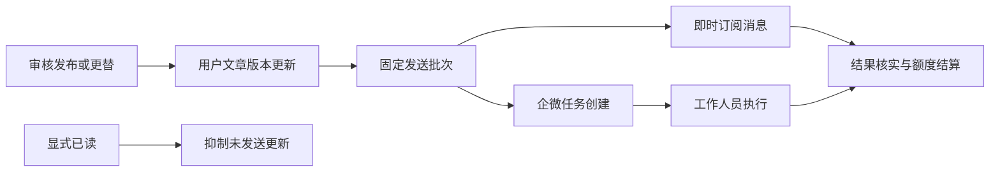

# 强提醒与后台重制开发交接

> 2026-10-16 本地候选更新：先读 [微信交互与企微运营收口交接](微信交互与企微运营收口交接-20261016.md) 和 [当前验收结果](当前阶段与验收结果.md)。新分支 `feature/wechat-ux-closure-20261016` 尚未推送；本页旧分支和验收数字是历史记录，变更状态以最新交接为准。

适用分支：`feature/reminder-admin-rebuild`。本轮接手此前 SR-01～08 的本地业务部分，新增 V21、V22。正式平台接线及真实发送未验收，不以本文作为上线许可。测试数字以本轮最终 JSON 报告为准。

## 1. 交付结构与来源

后台保持 Vue Web；客户保持同一套 uni-app 源码构建 H5 和微信小程序。后端继续使用现有公司基座和配置，不升级替换依赖栈。没有复制 gld0.5、hd0.5、xyzx0.7 的业务代码或 SQL；旧菜单截图只用于核对用户习惯。

原始管理员前端已丢失，因此本轮没有声称“恢复原版前端”。现有后端账号/角色/部门/菜单等基座能力继续使用，新后台按能力重新组织。来源核查见 `reports/provenance.json`，原有基座来源承认与新的业务来源分别记录。

## 2. 已实施的管理端变化

- 侧栏按业务分组，默认仅当前组展开；其他分组可以手动展开。
- 面包屑具有首页和编辑页返回列表链接；保留原有路由。
- 新入口 `/catalog-tree` 将板块、标签层级路径、关键词编排集中为三个工作区。板块和标签编辑沿用现有独立页面。
- 标签与关键词使用显式多对多编排，关键词实体保持全局唯一身份。标签版本用于并发编辑检查。
- 客户关键词页合并显式编排和已发布文章推导关系并去重；原 `/labels/{id}/keywords` 保持推导语义，新 `curated-keywords` 明确返回运营编排。
- 每日设置、即时设置、模板标识可以保存；新提醒规则和批次采用服务端分页；提醒统计从全部批次聚合，不以最近数百条样本冒充总量。
- 企微任务、统一记录、未知结果核实、明确失败后的受控补提具有实际接口和操作审计。

## 3. 新提醒业务规则

新变更跟踪路由位于 `/api/v1/me/reminders/**` 和 `/api/v1/admin/reminders/**`，区别于原 `/notifications/**`。这是新资源模型，不隐式重解释旧规则。

### 日常

用户选择全局时段和接收开关，跟踪某篇资讯或关键词。文章跟踪在审核发布新版本或更替时产生更新；关键词跟踪在新文章首次发布命中时产生更新。同文草稿修改不触发，关键词普通修订不触发。

同一用户、文章、确切版本只有一条更新，多条规则命中通过匹配关系保存来源。没有新变化不创建空任务；已显式读取同一或更新版本时抑制尚未发送的更新。阅读旧版本不能消除新版本变化。

到用户选择时段，系统将待发项冻结为用户级批次。每次最多 200 项，超出部分留待后续日期；该上限是当前容量策略，交付前应按实际用户量评估。待企微人工执行的批次不会因到达下一个时段而再次创建。

默认时间为 Asia/Shanghai 的 08:00、13:00、17:00，仅是本地可用默认值。管理员可改三个不同时间；用户选择按旧时段位置映射到新时段，同日已创建的批次不重建。当前策略为当天到点后可以补建一次，不追赶过去所有日期。

用户已读发生在企微任务提交之后时，系统不宣称撤回外部消息。企微任务必须依据实际执行结果核实，部分执行或未知保持在途。

### 即时

用户选择“下一次即时”需要有效可用授权；本地模拟须先通过受保护命令配置合成额度。下一次符合条件的变化单独成批；同一跟踪已有未结束即时批次时，不连续创建多个加急批次。

确定成功后消费一次预留额度，相关跟踪恢复日常模式；失败释放预留，UNKNOWN 保留预留，不自动重发或降级。期间产生的新变化在成功降级后仍可进入日常处理。

H5 不调用微信授权 API。小程序页面具有条件编译的授权调用，缺少经过验证的正式供应商时明确待接入，不把一次 accept 当成永久授权。

### 原有规则兼容

原 `notification_rule`、`notification_delivery` 及对应 API 的含义不变。具体时间 AT_TIME 和旧 DAILY/INSTANT 可从“原有日程提醒”查询、编辑、暂停或取消。旧 API 的取消是停用并保留规则/历史，不物理删除；可从该列表再次恢复，这一历史语义没有被悄悄改变。

旧规则不自动复制进新跟踪表，以免同一用户收两份提醒。正式切换时应列出旧规则，由接收方决定停用或按明确映射转换；本轮仅支持新跟踪从建立之后的变化开始。

## 4. 数据模型与事务边界

V21 新增：

| 表 | 职责 |
| --- | --- |
| reminder_control | 时段、时区、总开关、模板标识与配置版本 |
| reminder_preference | 用户接收开关、选定时段、最近批次日期 |
| reminder_tracking | 文章或关键词持续跟踪、即时/日常模式、乐观版本 |
| reminder_change | 用户对应的文章版本变化、当前状态 |
| reminder_match | 变化的命中来源与跟踪版本 |
| reminder_batch / reminder_batch_item | 固定发送集合和平台任务状态 |
| reminder_permission | 当前本地模拟绑定及一次性额度预留、消费 |
| reminder_local_receipt | 合成授权请求去重，仅本地受保护入口 |
| reminder_attempt | 每次提交结果；人工核实另写通用 audit_event |
| label_keyword_curation | 显式标签关键词编排 |

发布/更替与跟踪更新在同一数据库事务中持久化。已读和注销通过独立提醒服务衔接，没有 Notification→Engagement→Notification 循环依赖。

V22 在 control 增加轮转游标：每次处理最多 100 个候选用户，再从下一段继续，避免暂停、未来生效或等待授权用户长期占住前 100 名。未来生效更新保留 PENDING，到生效后才进入批次；领取任务按 next_attempt_at 排序，暂停/关停通道的任务延后检查。

首版使用 control 单行作为提醒域串行化入口，减少跨操作并发歧义；这是当前吞吐取舍，不是无限容量方案。生产扩容前应做实际负载测试，届时可按用户分片锁及队列拆分，但必须保留相同行为验收。

Worker 分为规划、领取、外部调用、结果结算。`ReminderWorker.tick` 显式暂停外层事务；平台网络调用不得放进持有业务锁的事务。领取时写租约和唯一 token；回执只处理对应当前租约。租约过期转 UNKNOWN，禁止盲目重新发送。



## 5. 代码入口

后端包根：`backend/agri-modules/yunji-content/src/main/java/com/sunshine/yunji/content`。

- `notification/application/ReminderTrackingService`：设置、跟踪、发布/更替捕获、已读和本地授权。
- `ReminderBatchService`：批次规划、发送租约、结算、核实、补提和全量统计。
- `ReminderWorker`、`ReminderJob`：分事务运行和可配置定时入口。
- `notification/api/ReminderController`、`ReminderViews`：新接口及显式 DTO，数据库内部字段不直接暴露。
- `notification/infrastructure/WecomTaskTransport`：客户联系群发任务 HTTP 适配器；与旧的企微内部应用消息接口分开。
- `catalog/api/CatalogCurationController`：编排维护与公开查询。
- `ArticleCommands`、`EngagementService`、`IdentityService`：发布、更替、已读和注销连接点。
- `apps/admin/src/views/DeliveryCenter.vue`、`CatalogTree.vue`：提醒运营中心和分类工作区。
- `apps/client/src/pages/notification-*`、`notifications`：用户提醒与兼容日程页面。

新增/修改表只能追加 V23 起迁移；V1～V22 一旦用于交付就不可原地修改。升级失败按现有迁移操作书处理，禁止因页面缺数据导入 demo 库。

## 6. 本地操作教程

从项目根目录执行：

```powershell
$env:PYTHONUTF8='1'
$env:YUNJI_TEST_MAVEN_SETTINGS=(Join-Path (Get-Location) '.runtime\maven-central-settings.xml')
python scripts/workbench.py start
```

Maven settings 仅在本机需要镜像配置时设置；接收团队使用自身标准 Maven 配置。启动工作台会创建新的纯合成库，不复用或修改先前人工测试数据。

工作台地址：客户 H5 `http://127.0.0.1:5173/`；管理员 `http://127.0.0.1:5174/`。本地管理员 `admin / admin123` 仅限此合成环境；生产启动会拒绝默认口令。

另开终端：

```powershell
python scripts/workbench.py code alice
python scripts/workbench.py authorize alice --quota 5
```

第一条签发一次性登录码，用于 C 端本地登录；第二条配置旧/新两套本地模拟授权和企微模拟绑定，不会发出真实消息。私密状态在 `.runtime`，不要上传。

人工试验：

1. 管理端创建资讯并审核发布；客户从详情“设置提醒”建立日常跟踪。
2. 在客户“强提醒设置”保存一个时段；需要立即演示时，将管理员三个时段之一设为当前业务日期已经经过的时间，再让用户选择该时段。
3. 管理端修订并审核发布新版本；客户提醒页应出现更新标题。
4. 在管理员推送记录执行一次任务处理；工作台也每 30 秒自动处理。企微模拟任务应显示“待企微人工执行”。
5. 通过“核实结果”填写明确的合成证据，记录确认发送；这只模拟企微工作人员及回执，并没有操作真实企微。
6. 测试即时：先配置合成额度，再把某条跟踪改为下一次即时，发布新版本，确认记录、额度和自动降级。
7. 测试已读：任务尚未提交时显式标记更新版本已读，确认该变化不再发送；平台任务已提交时不承诺撤回。

停止：`python scripts/workbench.py stop`，只停止该工作台创建的进程。

## 7. 自动验收及报告

```powershell
python scripts/build_acceptance.py
python scripts/reminder_acceptance.py
python scripts/acceptance.py
python scripts/browser_acceptance.py
python scripts/operations_acceptance.py
```

默认专项、API、浏览器使用同一组本地端口，按顺序运行；生产配置演练使用另一组端口。运行前关闭手工工作台。构建与测试期间冻结源码，最终报告须 `sourceUnchanged=true` 且指纹匹配，不能沿用修改前成绩。

- `reports/reminder-rebuild.json`：V20→V22 升级、新语义、权限、防重及恢复场景。
- `reports/latest.json`：原有 API 全套回归。
- `reports/browser*.json`、`browser-execution.json`：真实页面操作；新专项 `browser-reminder-rebuild.json`。
- `reports/operations.json`：生产配置拒绝、迁移、备份和恢复。
- `reports/build.json`：后端 verify、两端类型检查、H5 和小程序构建。
- `reports/security.json`：真实依赖扫描；风险不自动豁免。

## 8. 正式平台接入边界与接收方工作

当前运行 Worker 使用本地模拟，正式发送仍关闭，`realProviderReady=false`。`WecomTaskTransport` 已提供建任务、查询执行任务和接收结果的窄接口及 HTTP fixture 测试，但尚未与真实企业身份、模板及回执状态绑定。它不是完整生产发送器，不能仅填一个密钥就宣布上线。

资源齐备后须完成：

1. 确认客户联系群发权限、发送员工与客户关系，把本系统用户绑定到准确的 external_userid；不要将 openid/unionid 直接复用为企微 ID。
2. 依据小程序真实订阅事件建立服务端授权证据，区分用户操作、模板许可和实际平台拒绝；不能调用本地授权接口制造生产额度。
3. 将加密身份解析、模板字段与跳转页面映射接到发送接口，令生产 Worker 使用实际适配器，并验证事务外调用。
4. 任务创建成功写“待员工执行”；按平台分页查询结果，完整处理部分失败、执行延迟、无回执和未知状态。不能仅根据 errcode=0 写已送达。
5. 验证平台实际批量操作与频次限制，以及账户未授权、解绑、超时、重复回执等情形。当前声明的三个时段和界面“一键发送”仍需要业务签字及平台实测。
6. 在 Linux amd64 Docker 目标环境验证生产开关、自动调度、日志、私有文件、备份恢复。现有依赖风险按安全处置文档处理，不因本地功能通过而豁免。

以上包含平台相关开发和真实联调，不仅是运维填参数。本地通过不能替代这些工作。此次用户接手授权不意味着可以凭缺失资源编造平台可用证明。

## 9. 已知容量与产品边界

- 新提醒列表提供真实分页；其他历史运营列表部分仍有既有数量上限，本轮未把所有业务表格统一改成无限量报表。
- 分类编排不是订阅继承；父标签仍不自动关注所有子标签。
- 暂停跟踪会阻止未提交匹配；平台已接受的任务可能仍被执行。已进入但未提交的批次在领取时再次检查权限、版本、已读和有效跟踪。
- 日常默认 200 项/用户/批次、每次规划 100 用户、每次处理 100 批次；持续积压应报警并评估吞吐，而不是修改后台显示数字。
- 本轮不迁移旧线上数据，不恢复公众号提醒，不导入旧业务源码，不公开发布或推送 GitHub。

## 10. 新接口速查与二次开发步骤

所有受保护请求都遵循已有 token/realm 与权限规则。写请求携带 `Idempotency-Key`；业务对象修改另携带 `expectedVersion`。二者分别解决网络重复提交和多人编辑冲突，不能互相替代。生产不存在给客户自行增加额度的接口。

| 路径（省略 /api/v1） | 操作 | 用途 |
| --- | --- | --- |
| `/me/reminders/settings` | GET / PUT | 用户开关、时段、版本与模拟授权状态 |
| `/me/reminders/rules` | GET / POST | 分页跟踪列表、新建跟踪；mode 可筛选 DAILY / INSTANT |
| `/me/reminders/rules/{id}` | GET / PUT | 自己的跟踪详情、修改或暂停 |
| `/me/reminders/changes` | GET | 当前可见内容的待处理更新，标题与确切版本 |
| `/me/reminders/changes/{id}` | DELETE | 忽略尚未入批的单条变化，保留跟踪 |
| `/me/reminders/batches` | GET | 自己的批次记录，分页返回 |
| `/admin/reminders/settings` | GET / PUT | 三个时段、时区、总开关和模板标识 |
| `/admin/reminders/rules` | GET | 全部用户跟踪，服务端分页 |
| `/admin/reminders/batches` | GET | 按 state / channel 查询批次，企微页面只取 WECom |
| `/admin/reminders/statistics` | GET | 按通道/状态的全量汇总 |
| `/admin/reminders/tick` | POST | 受控执行一次规划/处理，不是人工创建每条任务的日常要求 |
| `/admin/reminders/batches/{id}/reconcile` | POST | UNKNOWN/待员工/部分执行的凭证核实 |
| `/admin/reminders/batches/{id}/retry` | POST | 仅明确 FAILED 可凭证补提；UNKNOWN 拒绝 |
| `/admin/catalog/curation` | GET | 板块/标签/关键词编排工作区 |
| `/admin/catalog/labels/{id}/keywords` | PUT | 显式编排，最多 100 个关键词，标签版本校验 |
| `/catalog/labels/{id}/curated-keywords` | GET | 公开的启用编排，不返回停用实体 |

精确字段、类型及状态以 `contracts/openapi.yaml` 和 `ReminderViews` 为准，ID 在 JSON 中是字符串，不转成 JavaScript Number。内部快照、租约 token 和数据库控制游标不出现在公开 DTO 中。

开发一个新提醒触发源：先写“何时触发、是否追溯、哪种已读抑制”的规则；在变更事务内调用提醒域；按用户/文章/版本唯一约束生成变化；增加匹配解释；通过同一个 plan/claim/finish 流程发送。不得在 Controller 或发布事务中直接 HTTP 调平台。新增状态要同时更新数据库检查约束、服务端状态机、客户/管理端文案和行为测试。

修改默认调度：`yunji.reminder.scheduler-enabled` 默认关闭；本地 workbench 显式开启，`yunji.reminder.poll-ms` 默认 30000 毫秒，启动后延迟 30 秒。调度器与文件回收/公司任务中心互不依赖，支持多个实例通过数据库串行化防重。生产当前即使开启调度也不会调用真实平台；这一限制必须等第 8 节接线完成后通过验收再解除，不能直接删保护。

故障诊断：先看全量统计中的 PENDING / WAITING_AUTH / UNKNOWN 和批次 errorCode，再看受限日志及 audit_event。缺授权时不改成 SENT；lease 到期时不删除记录重建；UNKNOWN 先查询平台，证据明确失败才进入受控补提。日常已入批但失败的项目属于原批次，补提使用原 batch id，不再生成第二份成员关系。

本地验证自动调度：专项验收在保留测试库的情况下仅重启它自己创建的 API 实例，开启调度、关闭文件回收，然后等待企微合成任务出现；全过程不调用管理 tick。该测试证明本地调度实际执行，不证明真实企微发送或生产吞吐。

配套 [基座能力与管理员重制清单](基座能力与管理员重制清单-20261013.md) 逐项区分继承后端能力、重制前端和未启用模块。

真实接入资料和接线顺序见 [平台接入待补资料与实施边界](平台接入待补资料与实施边界-20261013.md)。
