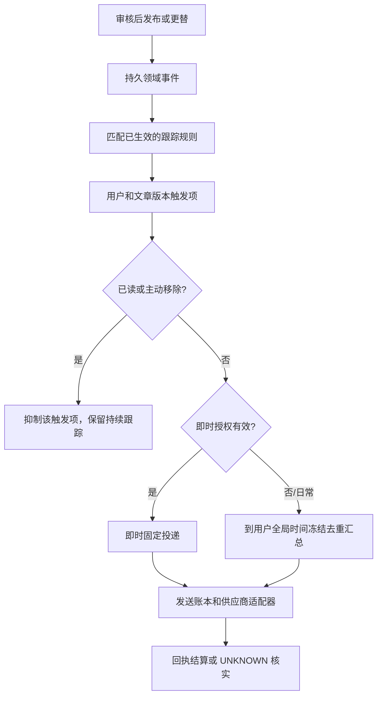

# 强提醒逻辑核查与后续开发说明

> 2026-10-13 更新：下文是 10 月 12 日静态审计历史，保留用于追溯。当前分支新增了变更跟踪模型和 V21，本地实现及剩余平台边界见 [重制开发交接](强提醒与后台重制开发交接-20261013.md)。旧 `/notifications` 语义仍保留，新能力在 `/reminders`，不可用旧审计数字替代最新运行报告。

> 后续处理决定：完整补齐评估为中高复杂度，按用户指示交接接手开发团队；具体分工、代码入口和验收条件见 [实施任务单](强提醒后续实施任务单-接手开发团队.md)。尚未实施。

核查日期：2026-10-12。结论：**重制版与 yangben 的强提醒不完全是同一业务逻辑。当前已经验证的是规则型提醒及本地投递账本，没有完整恢复旧样本的“变更触发 → 未读待推送 → 全局每日汇总 → 即时更替成功后降回日常”的流程。**

这不是只剩微信工具测试或生产配置的问题，其中有无需真实平台资源也能设计实现的本地业务缺口。页面拆分、三种规则构建成功，不能证明这些语义已一致。

本次范围是用户要求的只读比较和二次开发文档。没有改动提醒业务代码、没有修改旧样本、没有启动旧后端、没有导入旧库、没有新增业务迁移。以下“拟议方案”不计作已实现。

## 1. 样本选择与证据可信度

只读对比对象：

- 客户样本：`yangben/xyzx0.7/src/pages/my/reminder/`、`src/utils/strongRemind.js` 及相关请求声明。
- 后端样本：`yangben/hd0.5/cis4j/agri-modules/agri-system` 与 `agri-message` 中对应服务、Mapper 和调用点。
- 重制版：`yunji-platform` 的通知、文章、已读服务和 uni-app 提醒页面。

不读取备份 `.bak`、target/class 或 dist 文件作为主证据。样本前后端目录的版本并未由同一 Git 提交证明配套，因此记录“该源码中存在的行为”，不宣称旧工程每条链路可运行。

研究笔记有价值，但样本内《强提醒功能技术方案.md》仍描述服务号/本地关注标记，与当前源码的每日企微和即时订阅消息并不完全一致。文案、笔记、调用代码与实际可执行行为要分开判断。

## 2. 旧版表达的主要业务

### 2.1 日常强提醒

用户对某条信息或关键词设提醒，建立持久跟踪关系。

- 信息类：内容被更替时产生待推送明细，并把跟踪目标迁移到新信息。
- 关键词类：新建且未失效的信息命中关键词时产生待推送明细。该实现不把编辑同一条信息视为新建触发。
- 多个关键词可能命中同一信息；待推送数量按用户、消息去重。
- 详情或信息盒子显式已读会取消该用户该消息的活跃未发送明细，持续跟踪规则未必删除。
- 每日全局提醒时间由用户选择 08:00/13:00/17:00；源码中每日发送服务以企业微信外部联系人群发任务提交文本和小程序卡片。
- 没有活跃待推送明细时不创建每日汇总。

### 2.2 及时提醒

旧服务允许未触发的信息类提醒升级及时提醒；已触发、非信息类或已经及时的规则拒绝升级。前端工具函数先请求微信订阅消息授权。

信息更替的即时分支发送成功后，将规则迁移到新信息并降回日常。用户主动“移除及时提醒”的旧服务语义是降级，不等于彻底删除跟踪。

旧后端还包含关键词/标签匹配的即时服务以及具体时间扫描任务。这些并不是一个严密一致的统一状态机，不能据此直接承诺每类目标在所有入口都可用。

## 3. 与当前重制版逐项比较

| 事项 | yangben 对应源码行为 | 当前重制版 | 判断 |
| --- | --- | --- | --- |
| 提醒对象 | 主流程信息和关键词；部分即时服务另匹配 tag | ARTICLE/KEYWORD；标签关注不等于标签强提醒 | 主对象相似，不能把标签关注当提醒已完成 |
| 日常提醒触发源 | 信息更替/新建命中关键词生成触发项 | DAILY 到点直接取内容快照；INSTANT 消费 ARTICLE_PUBLISHED | 不同 |
| 同文编辑 | 关键词日常分支不把编辑当新建 | 新发布版本仍产生 ARTICLE_PUBLISHED，可命中 INSTANT | 不同，须明确产品期望 |
| 每日汇总对象 | 用户待推送变更，消息去重 | 按每条 DAILY 规则各建一份投递；关键词截取最多 20 条当前可见资讯 | 不同，不是全局未读变更汇总 |
| 没有新变化 | 没有活跃 trigger 则跳过每日群发 | 当前 DAILY 不检查新增变更，也不保证空内容不建投递 | 会产生重复或无变化提醒风险 |
| 待推送数量 | 去重的活跃消息数 | 提醒主页统计最近 200 条投递中待处理记录数 | 不同；投递数不是更新数 |
| 全局时间设置 | 用户级开关及 08:00/13:00/17:00 | 每规则任意有效 LocalTime；“强提醒设置”目前是引导说明 | 不同；尚无用户级每日配置闭环 |
| 已读联动 | 已读取消用户+消息未发送 trigger | EngagementService.read 只写 user_read_state 与审计 | 未实现提醒取消联动 |
| 提醒移除 | 日常移除取消当前消息明细，部分信息规则停用；及时移除降级 | 取消统一停用规则；暂停/恢复及改为即时 | 不同，不能直接重命名按钮 |
| 升级为及时 | 未触发信息类 + 请求订阅授权 | 可将定时/每日 ARTICLE 或 KEYWORD 改为 INSTANT；保存不验证真实平台授权 | 不同；业务限制与授权流程缺失 |
| 更替迁移 | 日常迁移并生成 trigger；即时成功后迁移并降回日常 | 所有文章规则迁移并增版本，重复目标规则停用；模式保留 | 迁移已实现，触发与降级未对齐 |
| 更替即时发送 | 旧更替调用专用即时服务 | 迁移自身未生成通知消费者可用的更替事件；tick 只消费 ARTICLE_PUBLISHED | 迁移不能证明更替即时投递已完成 |
| 攻略限制 | addRemind 拒绝 infoType=3 攻略 | 只要求文章可读，不排除 GUIDE | 不同，属于需批准的业务限制 |
| 具体时间提醒 | 有时间时至少提前 5 分钟 | AT_TIME 只要求未来 | 不同；五分钟不是通用行业规定 |
| 通道 | 源码每日企微、即时订阅消息；部分笔记仍写服务号 | WECHAT_SUBSCRIBE/WECom，公众号退役 | 按当前需求退役公众号合理；真实新通道尚未接线 |
| 发送证据 | 每日服务把群发任务创建成功后立即标记 trigger 已推送 | 本地模拟 SENT/UNKNOWN/失败账本；生产 tick 拒绝运行 | 不同；旧任务创建不能当成真实送达 |
| 防重和重试 | 分散额度消费、触发标记和任务记录 | 规则/投递快照、去重键、额度预占与结算、重试、UNKNOWN 冻结 | 重制基础更清晰，应保留 |

### 一个具体例子

用户跟踪“考试 A”和关键词“奖学金”。今天考试 A 没变，新增两条奖学金资讯，其中一条已读。

旧主流程的目标：生成新命中的待推送明细；已读的那条从待推送中取消；用户选定时间汇总剩余变化。同一资讯命中两个关键词也只计一条。

当前 DAILY：每规则在约定时间建立投递，文章规则可以再次包含未变化的考试 A，关键词规则从当前可见资讯中截取快照；已读状态不剔除，两个规则之间不做用户级资讯去重。

因此，当前“每日摘要”和旧“日常强提醒”不能作为同义词交接。

## 4. 旧源码中不能复制的实现风险

1. **前后端参数不一致。** 样本页面将 `{infoId}` 提交移除/降级；旧服务要求 `userRemindId/messageId/sourceType` 等。页面还以信息编号和标题调用 `setStrongRemindInstant`，工具函数定义却是提醒编号和消息编号。不能据页面存在就认定流程可运行。
2. **授权拒绝仍可能按成功处理。** 工具函数拒绝时 resolve false，而调用页面使用 `.then` 无条件移除日常条目。应显式检查返回状态，服务器也要验证业务状态。
3. **任务创建被当成发送成功。** 每日服务调用企微 `addMsgTemplate`，errcode=0 后立即标记全部活跃 trigger 已推送。这个调用结果只说明该接口请求成功，不能据此证明接收人已收到消息。
4. **批次边界不冻结。** 先统计 N，任务提交后再按用户更新所有当前活跃 trigger，期间新增明细可能被误归入已推送。新实现应明确固定批次包含哪些触发项。
5. **身份混用。** 旧即时发送把 `unionId` 字段优先当 openid。新工程保持 AppID 范围身份映射，不能复用这个字段约定。
6. **失败处理分散。** 旧任务先标触发再发送，未授权/配置缺失后的状态与重试入口容易不一致。对未知结果要有持久状态和可审查恢复，不能靠日志。

以上是静态源码核查发现，未对旧版进行运行验收。它们支持“按业务目的重新设计”，不支持复制旧方法或旧表。

## 5. 专业设计建议：保留目标，重写语义

**以下为拟议补齐方案，尚未实施，不属于现有验收通过项。**

### 5.1 先明确四类对象

1. 跟踪规则：用户持续跟踪文章或关键词，选择日常/下一次即时/指定时间等用途。
2. 内容触发项：某次经审核的发布/更替让某用户有新变化；绑定文章和确切版本，记录命中来源。
3. 汇总批次/投递：某个用户、时间窗口、通道的一次固定集合，不按“发送时全部当前待办”动态扩大。
4. 发送尝试和回执：记录供应商接受、发送中、明确送达/失败、UNKNOWN；额度与状态可核查。

优先复用新工程 outbox、投递账本、审计、幂等与额度结算基础。若需要新关系，追加 V21 起迁移；表设计根据新领域不变量完成，不能复制旧 `user_remind_trigger`。

### 5.2 推荐明确的业务规则

| 规则 | 推荐决定 |
| --- | --- |
| 日常目标 | 仅汇总上次成功处理之后新产生的可见变更；没有变化不发送 |
| 时间设置 | 用户级时区、开关和时间；旧三选一可以作为首版产品策略，不硬编码在多个页面/服务 |
| 触发事件 | 发布/修订/更替各有明确事件及用途；同文编辑是否触发由规则决定，不凭“行是 INSERT 还是 UPDATE”猜测 |
| 数量去重 | 明细按用户+文章+确切版本，汇总卡片按批准口径去重；多个命中来源保留用于解释 |
| 已读 | 显式读取同一或更新版本才抑制尚未发送的相关触发；旧版本已读不能消除新版本变化 |
| 在途已读 | 已发送/正在外部发送不能伪称撤回；按账本状态定义“停止待发”和“已无法撤回” |
| 移除 | 当前更新移除、持续跟踪取消、即时降级是三个不同动作和接口 |
| 即时升级 | 首版按旧主流程只允许未触发文章类；需要真实授权，拒绝不能移动列表或创建额度 |
| 即时更替 | 成功处理本次即时投递后再降回日常；失败/UNKNOWN 不自动降级或重新增加额度 |
| 隐藏内容 | 下线、权限变化或删除的内容不能泄漏到汇总；说明静默抑制或失败原因 |
| 配置迟到 | 服务重启/错过固定时间要有有限补发窗口；不逐日无限追赶旧 DAILY 时点 |
| 攻略与提前量 | 作为明确产品策略待确认；不以“行业要求”替代甲方业务选择 |
| 企微通道 | 先确认应用消息还是客户联系群发；两者身份、权限和回执不同 |

所有“规则保存成功”与“授权成功”分开反馈。公众号继续按本轮已批准方向退役，不恢复旧绑定横幅。

### 5.3 实施顺序与边界

| 阶段 | 可本地自主完成 | 外部依赖 |
| --- | --- | --- |
| A 语义冻结 | 状态机、目标类型、触发口径、全局时间、移除/降级、具体验收矩阵 | 最终产品策略如攻略限制/五分钟/每日时间白名单需接收团队确认 |
| B 模型和本地闭环 | 增量迁移、领域事件、触发项、版本级已读抑制、冻结批次、去重、取消/降级/迁移 | 无真实平台依赖，可用合成适配器验证 |
| C 两端 | 双列表使用真正待更新数据；全局设置可保存；数量与状态真实；编辑返回/刷新一致 | 小程序授权 API 需开发工具/平台配置 |
| D 正式通道 | 抽出供应商适配器、调度租约、超时/回执和恢复流程 | AppID/模板、企微身份与权限、HTTPS 回调、实际接收账号 |
| E 交付验收 | 空库/升级/API/页面/重启/重试/取消竞态及来源核查 | 真机、真实送达、Linux 环境签收 |

不能把 B/C 延迟开发归因为“没有平台资源”。当前核查只产出设计与差异，后续实施需另形成可审查代码和报告。

## 6. 下一轮必须执行的行为验收

以下是新语义验收要求，**尚未执行、尚未通过**：

- [ ] 同一版本/事件重复消费不增加触发项或额度消耗。
- [ ] 多个关键词命中同一文章，用户汇总更新数按约定去重。
- [ ] 没有任何新变化的日常时间不创建空投递。
- [ ] 新版本发布之后，旧版本已读不取消该新变化。
- [ ] 当前版本显式已读取消待发项，但不会删除持续跟踪关系。
- [ ] 读操作与汇总冻结并发时有可解释结果，不误把在途消息声明撤回。
- [ ] 更替未发送日常目标时，新目标迁移与触发原子持久化。
- [ ] 更替即时成功后只降级一次；失败/UNKNOWN 不假成功，不重复扣额度。
- [ ] 微信授权拒绝时列表不迁移；客户端 accept 不能自己生成生产额度。
- [ ] 当前更新移除与彻底取消跟踪作用不同，且不能跨用户操作。
- [ ] 全局开关/时间修改即时生效，未来批次有唯一键；静默与迟到窗口明确。
- [ ] 批次创建后新增的变化留在下个批次，不被本批处理清掉。
- [ ] 供应商任务创建与实际发送/送达分别记录；缺回执为未知或在途。
- [ ] 内容下线、账号注销、通道解绑后，不发送不可见正文。
- [ ] 崩溃恢复和多工作进程并发下不重复发送；无法确定送达时冻结核实。

已有 `tests/notification_ops_suite.py` 验证额度回调、规则权限、发布即时消费、定时一次、DAILY 前进、UNKNOWN 与重试。这些是保留资产，但没有覆盖上述全部旧语义。

## 7. 人工测试当前版时怎么理解

1. 从资讯详情“设置提醒”进入编辑，保存规则。当前默认 INSTANT；这并不是旧版默认日常跟踪。
2. 在规则主页暂停/恢复、取消或改为即时；这都是当前规则操作，不是按旧消息逐项移除。
3. 管理端“提醒账本”执行任务只运行本地 tick。工作台不会自动运行真实供应商。
4. 若缺合成授权，投递可能 WAITING_QUOTA；`python scripts/workbench.py authorize alice --quota 5` 仅供本地合成路径。
5. 设置 DAILY 可以验证按规则定时，但当前已读不会取消它，且没有变化也不保证跳过。
6. 更替后能看到目标迁移并不代表即时更替已发送；要区分规则、事件、投递与回执。

本次文档核查未重置人工测试库，未消耗用户登录码或修改规则。最终访问检查发现上一轮服务已停止；本轮未终止它，旧运行目录仍保留。后续需要试用时按教程启动，注意默认工作台启动会创建新测试库。

## 8. 源码证据定位

以下路径以工作区 `D:/yunjiwxCongxie/` 为基准。行号为本次核查位置，后续修改按方法名定位。旧路径只用于证据，不是新工程依赖。

| 编号 | 文件与定位 | 支撑结论 |
| --- | --- | --- |
| O1 | `yangben/hd0.5/cis4j/agri-modules/agri-system/src/main/java/com/sunshine/system/service/impl/UserRemindServiceImpl.java:68` addRemind | 无具体时间、五分钟限制、攻略拒绝 |
| O2 | 同文件 `:314` getDailyPendingRemind；`:435` upgradeDailyRemind；`:497` downgradeInstantRemind | 去重待推送、升级限制和降级 |
| O3 | `yangben/hd0.5/cis4j/agri-modules/agri-system/src/main/java/com/sunshine/system/service/impl/DailyRemindServiceImpl.java:91` saveDailySetting；`:132` pushDailyRemind | 全局时间、企微任务、计数/标记范围 |
| O4 | `yangben/hd0.5/cis4j/agri-modules/agri-system/src/main/java/com/sunshine/system/mapper/UserRemindTriggerMapper.java` | 按用户/消息取消、COUNT DISTINCT、全量标记 |
| O5 | `yangben/hd0.5/cis4j/agri-modules/agri-message/src/main/java/com/sunshine/message/service/SubMessageReadService.java:46` | 已读取消活跃待推送 |
| O6 | `yangben/hd0.5/cis4j/agri-modules/agri-message/src/main/java/com/sunshine/message/service/impl/InfoSyncService.java:113` | 新建命中关键词才产生日常触发 |
| O7 | `yangben/hd0.5/cis4j/agri-modules/agri-message/src/main/java/com/sunshine/message/service/impl/SubMessageReplaceConfirmServiceImpl.java:342` | 日常更替触发与目标迁移 |
| O8 | `yangben/hd0.5/cis4j/agri-modules/agri-system/src/main/java/com/sunshine/system/service/impl/InstantRemindPushServiceImpl.java:109` | 即时更替成功调用 downgradeToDailyForReplace |
| O9 | `yangben/xyzx0.7/src/utils/strongRemind.js` 和 `src/pages/my/reminder/reminder.vue:276` | 授权函数与页面参数/返回值不一致 |
| N1 | `yunji-platform/backend/agri-modules/yunji-content/src/main/java/com/sunshine/yunji/content/notification/application/NotificationService.java:24` rule；`:51` enqueue；`:57` tick；`:75` process | 三模式、快照、仅发布事件、本地调度与账本 |
| N2 | `yunji-platform/backend/agri-modules/yunji-content/src/main/java/com/sunshine/yunji/content/engagement/application/EngagementService.java:22` read | 仅写已读版本和审计 |
| N3 | `yunji-platform/backend/agri-modules/yunji-content/src/main/java/com/sunshine/yunji/content/article/application/ArticleCommands.java` migrateSubscriptions | 保留模式迁移；没有专用更替即时投递 |
| N4 | `yunji-platform/apps/client/src/pages/notification-settings/index.vue`、`notifications/index.vue` | 设置页引导、最近投递数和规则 Tab |

源文件 SHA256 与当前应用指纹见 `reports/strong-reminder-audit.json`。该报告 scope 为只读静态逻辑审计，不是运行通过报告，不替代验收脚本。
